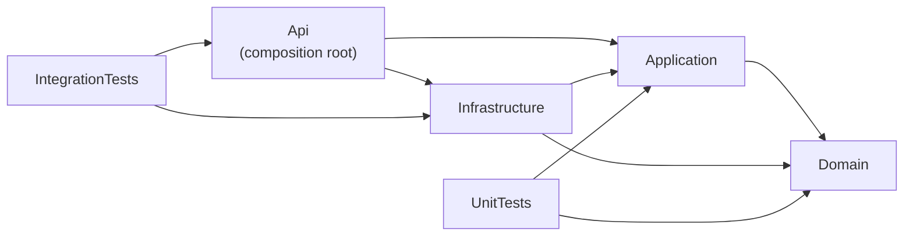

# Architecture

Status: **design document**. Sections describe agreed decisions; nothing here claims a feature is implemented. Implementation status lives in [checklist.md](checklist.md).

## 1. Layering



**Rule:** dependencies point inward. Domain references no project. Application never references Infrastructure or Api. The only place concrete implementations are wired to interfaces is `Api` (dependency injection setup).

| Layer | Responsibility | Examples |
|---|---|---|
| **Domain** | Entities, enums, invariants and state rules that need no framework. | `Course` status transitions, `Submission` attempt rules |
| **Application** | Use cases. Defines the interfaces it needs and the DTOs and validators for its inputs and outputs. | `ICourseService`, `IApplicationDbContext`, `IEmailService`, `ICloudinaryService`, FluentValidation validators |
| **Infrastructure** | Implements what Application declares, using real technology. | EF Core `DbContext`, Identity stores, Mailpit/HTTP email sender, Cloudinary client, `BackgroundService` jobs |
| **Api** | HTTP only: controllers, authentication and authorization setup, middleware, Swagger. Controllers stay thin and call Application services. | `AuthController`, exception-handling middleware |

## 2. Design decisions and trade-offs

| Decision | Why | Trade-off / alternative |
|---|---|---|
| **Controllers, not minimal APIs** | 60+ endpoints are easier to organise per resource; attribute-based authorization, filters and Swagger annotations are mature and easy to explain. | Slightly more ceremony than minimal APIs. |
| **`ApplicationUser` in Domain, inheriting `IdentityUser<Guid>`** | Identity already provides password hashing, lockout, tokens and security stamps; the user entity needs those fields. | Domain takes one small framework dependency (`Microsoft.Extensions.Identity.Stores`). The alternative is a separate user entity plus mapping code, which adds risk and no benefit. |
| **No generic repository** | EF Core's `DbContext` is already a repository and unit of work. A wrapper hides query behaviour (includes, projections) and adds code. | Application services depend on EF Core types through `IApplicationDbContext`. Accepted. |
| **`IApplicationDbContext` in Application** | Lets Application services query and save without referencing Infrastructure, and lets unit tests substitute it. | Application references the EF Core package. |
| **Business rules in Domain/Application, not controllers** | Rules such as "only students enroll" must hold regardless of which endpoint calls them. | None significant. |
| **DTOs for all requests and responses** | Prevents over-posting (mass assignment) and accidental exposure of entity fields. | Explicit mapping code. |
| **Central Package Management** (`Directory.Packages.props`) | One place for every NuGet version, so projects cannot drift apart. | None significant. |
| **`.slnx` solution format** | Default in the .NET 10 SDK; readable XML, fewer merge conflicts. | Some older third-party tools only read `.sln`. |
| **xUnit v2 template** | Stable, widely documented, works with Testcontainers and `WebApplicationFactory`. | xUnit v3 is newer; migration is possible later. |
| **Nullable warnings are errors** | Null bugs fail the build instead of reaching runtime. | Slightly stricter coding. |
| **Real SQL Server in tests (Testcontainers)** | SQLite or the in-memory provider do not enforce SQL Server constraints, transactions, collations or concurrency tokens the same way. | Tests need Docker and are slower. |
| **Hosted `BackgroundService` for reminders** | One API instance; no extra infrastructure. Idempotency comes from a unique notification key in the database. | If the API is ever scaled to several instances, a distributed lock or a job scheduler would be needed. Documented, not built. |
| **No URL-versioning package in v1** | `/api/...` routes are enough for one client. | Versioning can be added before a breaking change. |

## 3. Agreed v1 business rules (summary)

**Roles.** `Student`, `Teacher`, `Admin`. Exactly one per user. Public registration always creates a Student. Only an admin can promote to Teacher or Admin. Only students can enroll; teachers cannot enroll in any course.

**Course workflow.**

```text
Draft -> PendingApproval -> Published | Rejected
Published -> Archived
```

- A teacher submits a Draft for review; an admin approves or rejects it.
- Only `Published` courses can be enrolled in.
- Known v1 limitation: a teacher may edit a published course without re-approval. The state machine is built so a re-approval rule can be added later.
- Open details to confirm in Week 2 before coding: what a teacher can do with a `Rejected` course (proposal: edit, then resubmit); whether `Archived` is terminal; what enrolled students can still see in an archived course.

**Assignments and submissions.** Every attempt is its own row. `MaxAttempts` defaults to 1. History is preserved. Text submissions first; attachments only if time permits.

**Time.** All timestamps are UTC. Each user has an optional IANA `TimeZoneId` (default `UTC`) used to decide what a "learning day" is for streaks and when deadline reminders are due. Daylight-saving transitions are handled by converting with the time-zone database, never by adding fixed offsets.

**Scope.** Free courses only. No payments, no quizzes. Discussions are included.

## 4. Authentication design (not yet implemented)

| Topic | Design |
|---|---|
| Passwords | ASP.NET Core Identity hashing and password policy. No custom hashing. |
| Registration | Always Student. Email verification required before login. Verification tokens come from Identity, are time-limited, and the resend endpoint is rate-limited and reveals nothing about whether an address exists. |
| Access token | JWT, lifetime of at most 15 minutes, returned in the JSON body. The Angular app keeps it in memory, never in `localStorage`. |
| Refresh token | Random value, stored only as a hash. Delivered in an `HttpOnly` cookie; `Secure` and `SameSite=Strict` in production; cookie `Path` limited to `/api/auth`. Rotated on every use. |
| Reuse detection | Each token belongs to a "family". Presenting an already-rotated token revokes the whole family. |
| CSRF | The refresh and logout endpoints require a custom request header that cross-site forms cannot send, in addition to `SameSite` and a narrow CORS allow-list. |
| Lockout | Identity lockout after repeated failed logins; generic error messages. |
| Seeded admin | Created from environment variables or user-secrets only when no admin exists. Flagged `MustChangePassword`; until changed, every endpoint except change-password and logout is refused. |
| Safeguards | The last active admin cannot be demoted or deactivated. Every role change writes an audit-log entry. Disabled users are rejected even when holding a valid access token. |

Local development works over `http://localhost` because browsers treat ports on the same host as the same site. Production needs HTTPS for `Secure` cookies; see the deployment documentation (Week 4) for what is possible without a domain.

## 5. Local database options

| Option | Use |
|---|---|
| **SQL Server in Docker** (Compose) | Default for development, integration tests and CI. Same engine everywhere. |
| **Local SQL Server Express** (`.\SQLEXPRESS`) | Optional alternative when running the API from Visual Studio. Uses Windows Authentication. |

Note for local Express: `sqlcmd -C` and `TrustServerCertificate=True` in a connection string both mean "accept the server's certificate without validating it". That is acceptable on a development machine and must never be used in production configuration.
