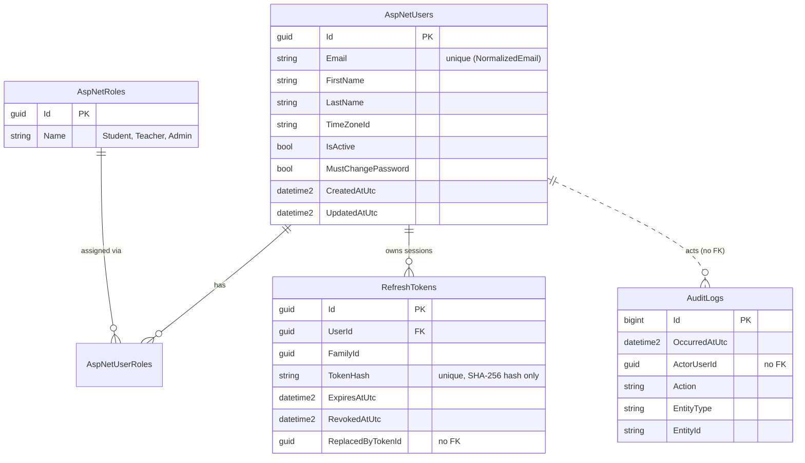

# Database design

Status: **foundation schema** (migration `InitialFoundation`). Later entities (courses, lessons, enrollments, ...) arrive through their own migrations and are added to this document as they are built.

## ER diagram (foundation)



Identity's other tables (`AspNetUserClaims`, `AspNetUserLogins`, `AspNetUserTokens`, `AspNetRoleClaims`) exist but are not used by the platform yet and are omitted from the diagram.

## Conventions

| Topic | Rule |
|---|---|
| **Keys** | `Guid` keys generated by EF Core (SQL Server-friendly sequential GUIDs). `AuditLogs` uses a `bigint IDENTITY` key. |
| **Time** | Every timestamp is UTC in a `datetime2` column. Domain methods reject non-UTC `DateTime` values. A value converter labels values as UTC when read back. The clock is `TimeProvider`, never `DateTime.UtcNow`. |
| **CreatedAtUtc / UpdatedAtUtc** | Entities implementing `IAuditableEntity` are stamped by `ApplicationDbContext.SaveChanges*`. Application code never sets them. |
| **Strings** | Every string column has an explicit maximum length, shared as a constant between the domain and the EF mapping. |
| **Concurrency** | Identity entities carry a `ConcurrencyStamp`. Platform entities that can be edited concurrently get a `rowversion` token when they are introduced. |
| **Reference data** | The three roles are seeded inside the migration with fixed ids. No user or password is ever seeded by a migration. |
| **Migrations** | Created in the Infrastructure project, stored in `Persistence/Migrations`, never applied automatically in production. |

## Design decisions worth defending

- **Refresh tokens are stored as hashes.** A database leak must not yield usable sessions. The unique index on `TokenHash` also serves the lookup on every refresh.
- **`FamilyId` models a login session.** All tokens produced by rotating one login share it, so reuse of an old token can revoke the whole session in one statement.
- **`ReplacedByTokenId` is not a foreign key.** A self-referencing cascade chain through the user would create multiple cascade paths, which SQL Server rejects. The column is informational (audit trail); integrity is enforced by the application.
- **`AuditLogs.ActorUserId` is not a foreign key.** Audit records must outlive the user they describe and must not block deleting that user.
- **Unique index on `NormalizedEmail`.** Identity only checks duplicates in code; the database constraint closes the race between two simultaneous registrations.
- **No DB default for booleans.** An EF Core default of `true` on a `bool` conflicts with the CLR default `false` and can silently overwrite an explicit `false`. Defaults live in the C# property initialisers.
- **Role is not a column on the user.** Roles live in Identity's role tables. "Exactly one role per user" is enforced by the role-management service.

## Migration commands

Run from the repository root. The Infrastructure project holds the migrations; the Api project is the startup project that supplies configuration.

```powershell
# Create a migration (does not touch the database)
dotnet ef migrations add <Name> --project src/OnlineLearningPlatform.Infrastructure --startup-project src/OnlineLearningPlatform.Api --output-dir Persistence/Migrations

# Apply pending migrations to the database named by ConnectionStrings:DefaultConnection
dotnet ef database update --project src/OnlineLearningPlatform.Infrastructure --startup-project src/OnlineLearningPlatform.Api

# Undo the most recent migration file (only if it has NOT been applied anywhere shared)
dotnet ef migrations remove --project src/OnlineLearningPlatform.Infrastructure --startup-project src/OnlineLearningPlatform.Api
```

Production deployments will use a reviewed SQL script or migration bundle instead of `database update` (documented in Week 4).

## Known risks

- **Data Protection keys.** Identity's email-confirmation and password-reset tokens are protected with ASP.NET Core Data Protection keys. If the key ring is lost on restart, outstanding tokens stop working. The key ring will be persisted before deployment.
